<picture>
  <source media="(prefers-color-scheme: dark)" srcset="./dark.svg">
  <source media="(prefers-color-scheme: light)" srcset="./light.svg">
  
</picture>

## Hello, I'm Divvela Hemanth Kumar 👋

I'm an **Aspiring Data Analyst** and a B.Tech graduate in Information Technology. I enjoy working with data, exploring patterns, and building practical applications with Python and web technologies.

- 📍 Based in Hyderabad, Telangana
- 🎓 B.Tech · Information Technology — Bapatla Engineering College
- 💼 Data Science Intern at Coding Rajas Technologies (May 2024 – Jul 2024)
- 🔎 Interested in data analysis, data preparation, exploratory analysis and practical machine-learning applications.

## Focus Areas

- **Data analysis:** cleaning, preprocessing and exploratory data analysis
- **Python ecosystem:** Python, Pandas and NumPy
- **Databases:** MySQL, MongoDB and DBMS fundamentals
- **Application development:** Flask, JavaScript, HTML and CSS
- **Productivity & AI tools:** Microsoft Office, Generative AI and prompt engineering

## Experience

### Data Science Intern · Coding Rajas Technologies
*May 2024 – July 2024 · Virtual*

- Analyzed **8,154 Netflix records** using Python, Pandas and NumPy.
- Worked on data cleaning, preprocessing and exploratory data analysis.
- Developed a movie recommendation system using TF-IDF and cosine similarity.
- Built a credit-card fraud detection model using the Random Forest classification algorithm.

## Featured Projects

### Employee Management System
*Python · Flask · MongoDB · HTML · CSS · JavaScript*

- Built a web application to enter, view, update and delete employee records.
- Connected Flask with MongoDB for employee data storage and retrieval.
- Added employee report generation in Excel and PDF formats.

### AI-Integrated Online Assessment Platform
*React.js · JavaScript · Node.js · MongoDB · Python*

- Developed a web platform for conducting online assessments.
- Implemented user authentication, exam scheduling and question management.
- Integrated REST APIs with MongoDB and displayed results with feedback after submission.

### Movie Recommendation System
*Python · TF-IDF · Cosine Similarity*

- Created a recommendation system to suggest movies and TV shows with similar content.

### Credit Card Fraud Detection
*Python · Random Forest*

- Built a classification model to identify potentially suspicious transactions.

## Technical Stack

| Area | Technologies |
|---|---|
| Programming | Python, JavaScript |
| Data analysis | Pandas, NumPy |
| Databases | MySQL, MongoDB, DBMS |
| Web | Flask, HTML, CSS, React.js, Node.js |
| Productivity | Microsoft Excel, Word, PowerPoint, Outlook |
| AI tools | Generative AI, Prompt Engineering, ChatGPT, Claude AI |
| Documentation | Data Entry, Document Editing |

## Education

- **Bapatla Engineering College** — B.Tech, Information Technology (2021–2025) · CGPA: 6.8
- **Narayana Junior College** — Intermediate (2019–2021) · 83.6%
- **Bhashyam High School** — SSC (2018–2019) · CGPA: 8.7

## Certifications

- Deloitte — Data Analytics Job Simulation Certificate (March 2026)
- TCS — GenAI Powered Data Analytics Job Simulation Certificate (March 2026)
- Coding Rajas Technologies — Data Science Internship Certificate (May–July 2024)
- IBM SkillsBuild — Prompt Engineering for Everyone (November 2024)

## Connect

- **GitHub:** [Heus143](https://github.com/Heus143)
- **LinkedIn:** [hemanthkumardivvela](https://linkedin.com/in/hemanthkumardivvela)
- **Portfolio:** [Visit portfolio](https://hemanthportfolio-be47.onrender.com)
- **Email:** [hemanthkumardivvela@gmail.com](mailto:hemanthkumardivvela@gmail.com)

---

  Thanks for visiting my profile.

